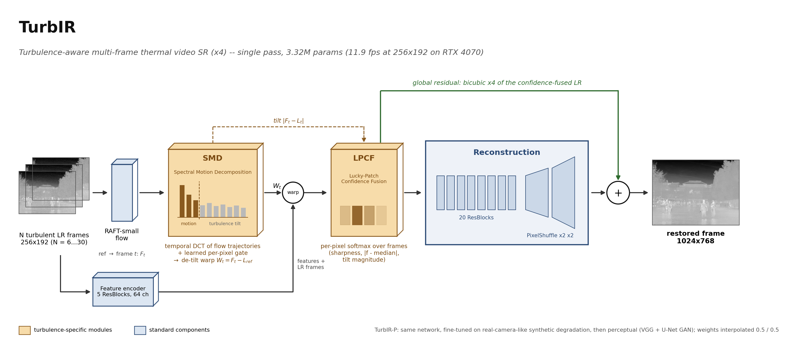
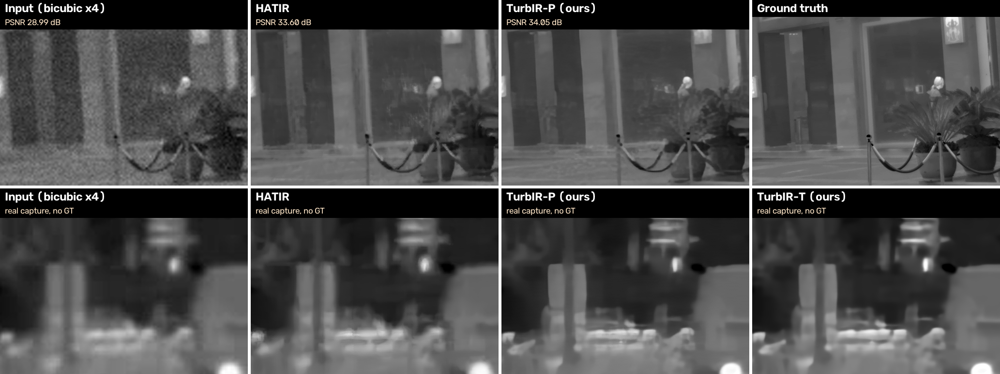
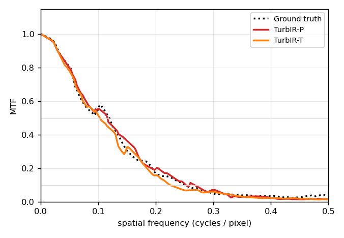

# TurbIR

**Turbulence-aware InfraRed restoration**: multi-frame x4 super-resolution for thermal video degraded by
atmospheric turbulence. A window of low-resolution frames goes in, the restored x4 centre frame comes out
in a single forward pass.

- 3.32M parameters
- 25.7 FPS with TensorRT, 11.9 FPS in PyTorch (256x192 -> 1024x768, RTX 4070)
- Better than HATIR (AAAI 2026) on PSNR, SSIM, LPIPS, DISTS and VMAF, at about 1,700x its speed

## Architecture

<div align="center">
  
</div>

1. **Optical flow**: RAFT-small, from the reference frame to every frame in the window.
2. **SMD (Spectral Motion Decomposition)**: splits each pixel's flow over time into real motion and
   turbulence tilt (temporal DCT + learned gate).
3. **Feature warp**: aligns every frame's features to the reference with the de-tilted flow.
4. **LPCF (Lucky-Patch Confidence Fusion)**: fuses frames with per-pixel confidence weights.
5. **Reconstruction**: 20 residual blocks + PixelShuffle x4 on top of a bicubic upscale.

## Structure

```
.
├── model/model.py           TurbIR
├── infer/
│   ├── infer.py             inference class / CLI
│   ├── trt_engine.py        optional TensorRT engine (--trt)
│   ├── data_io.py           frame / video I/O
│   └── ckpt_crypto.py       encrypted checkpoint loader
├── checkpoints/
│   ├── turbir_p.pth.enc
│   └── turbir_t.pth.enc
├── Dockerfile
└── requirements.txt
```

## Setup

```bash
pip install -r requirements.txt
pip install tensorrt-cu12==10.16.1.11 onnx    # optional, for --trt
```

## Checkpoints

| File | Use |
|---|---|
| `turbir_p.pth.enc` | default, best perceptual quality |
| `turbir_t.pth.enc` | highest PSNR, least flicker on video |

The checkpoints are encrypted. Set the key (available from the author) before running:

```bash
export CKPT_KEY=<key>
```

## Inference

```bash
cd infer
python infer.py --input /path/to/frames --out-dir ./out
python infer.py --input capture.mp4 --out-dir ./out --video ./out.mp4 --ckpt ../checkpoints/turbir_t.pth.enc
python infer.py --input /path/to/frames --out-dir ./out --trt     # TensorRT, ~2x faster
```

| Option | Default | |
|---|---|---|
| `--input` | – | frame directory (sorted by name) or video file |
| `--out-dir` | – | output PNG directory |
| `--ckpt` | `../checkpoints/turbir_p.pth.enc` | checkpoint |
| `--num-frames` | 15 | temporal window |
| `--tile H W` | 264 344 | maximum LR tile (12 GB GPU); `0 0` disables tiling |
| `--precision` | bf16 | `bf16` or `fp32` |
| `--video` / `--fps` | – / 10 | also write an mp4 |
| `--trt` | off | TensorRT engine, built once per input size (~1.5 min) and cached |

```python
from infer import TurbIRRestorer

restorer = TurbIRRestorer('../checkpoints/turbir_p.pth.enc')
for t, hr in restorer.restore_sequence(frames):   # frames: (T, H, W) uint8 -> hr: (4H, 4W) uint8
    ...
```

## Results

<div align="center">
  
</div>

**FLIR-IVSR test** (30 sequences x 6 frames, full 1024x768 frames)

| | PSNR | SSIM | LPIPS ↓ | DISTS ↓ | VMAF |
|---|---|---|---|---|---|
| HATIR | 33.73 | 0.906 | 0.193 | 0.172 | 33.8 |
| **TurbIR-P** | 34.33 | 0.913 | **0.156** | **0.144** | 40.9 |
| **TurbIR-T** | **34.73** | **0.928** | 0.213 | 0.197 | **47.9** |

**FLIR-IVSR test, real-camera blur and JPEG added**

| | PSNR | SSIM | LPIPS ↓ | DISTS ↓ | VMAF |
|---|---|---|---|---|---|
| HATIR | 31.66 | 0.890 | 0.350 | 0.289 | 5.7 |
| **TurbIR-P** | 32.84 | 0.903 | **0.280** | **0.246** | 20.0 |
| **TurbIR-T** | **33.32** | **0.910** | 0.325 | 0.278 | **29.4** |

**Real turbulent capture (TIID, no ground truth)**

| | NIQE ↓ | Sharpness ↑ | Flicker ↓ |
|---|---|---|---|
| HATIR | **8.96** | 1.43 | 0.470 |
| TurbIR-P | 10.01 | 1.35 | 0.443 |
| TurbIR-T | 9.72 | **1.49** | **0.439** |

**Speed** (RTX 4070 12 GB)

| Input | PyTorch | TensorRT |
|---|---|---|
| 256x192 -> 1024x768 | 11.9 FPS | 25.7 FPS |
| 640x480 -> 2560x1920 | 1.74 FPS | 3.33 FPS |
| HATIR, 256x192 | ~65 s/frame | – |

## Spatial resolution (MTF)

ISO 12233 slanted-edge measurement on 23 real edges from the FLIR-IVSR test set (median), restored from the
dataset's turbulent input and compared with the original HR frame.

<div align="center">
  
</div>

| | MTF50 (cy/px) | MTF10 (cy/px) | 10-90 % edge width | MTF50 / GT |
|---|---|---|---|---|
| Ground truth | 0.090 | 0.248 | 6.2 px | 1.00 |
| TurbIR-P | 0.101 | 0.252 | 5.7 px | 1.03 |
| TurbIR-T | 0.097 | 0.224 | 6.2 px | 0.98 |

Both models restore the resolution of the original frame.

## License

All rights reserved. Third-party components: see `THIRD_PARTY_NOTICES.md`.

## Data

- Training and test: [FLIR-IVSR](https://huggingface.co/datasets/Ophil/FLIR-IVSR) (GPL-3.0)
- Real capture: [TIID](https://zenodo.org/records/8002688) (CC-BY-4.0), evaluation only
